# PROJECT REPORT

## CampusOps — Unified Campus Operations & Event Lifecycle Engine

Submitted in partial fulfilment of the requirements for the award of the degree of

**BACHELOR OF TECHNOLOGY**  
**IN COMPUTER SCIENCE & ENGINEERING**

### Submitted by

**Vineet Kumar Sahu**  
URN: **231390690111**  
University Roll No.: **231134**

### Under the guidance of

**Ms. Rubi**  
Assistant Professor, Department of Computer Science & Engineering

**Department of Computer Science & Engineering**  
Global Institute of Technology and Management  
Farrukhnagar, Haryana

Academic Year: **2026–2027**  
Semester: **7th Semester**

---

## CERTIFICATE

This is to certify that the project report entitled **“CampusOps — Unified Campus Operations & Event Lifecycle Engine”** is the bona fide work of **Vineet Kumar Sahu (URN: 231390690111; University Roll No.: 231134)**, carried out under my guidance in partial fulfilment of the requirements for the award of the degree of Bachelor of Technology in Computer Science & Engineering from Global Institute of Technology and Management, Farrukhnagar, Haryana.

To the best of my knowledge, the work presented in this report is the student’s own work and has not been submitted, in whole or in part, for the award of any other degree or diploma at this or any other institution.

 

| Project Guide | Head of Department |
|---|---|
| **Ms. Rubi** | **Head of Department, CSE** |
| Assistant Professor, CSE | Global Institute of Technology and Management |
| Global Institute of Technology and Management | Farrukhnagar, Haryana |

Date: ____________________  
Place: Farrukhnagar

---

## CANDIDATE’S DECLARATION

I, **Vineet Kumar Sahu**, hereby declare that the project work presented in this report entitled **“CampusOps — Unified Campus Operations & Event Lifecycle Engine”** is my own work, carried out under the guidance of **Ms. Rubi, Assistant Professor, Department of Computer Science & Engineering**, Global Institute of Technology and Management, Farrukhnagar, affiliated to Gurugram University, Gurugram.

The work embodied in this report has not been submitted by me for the award of any other degree or diploma. Wherever the work of other authors or sources has been used, it has been acknowledged in the references.

Date: ____________________  
Place: Farrukhnagar

**Candidate’s signature:** ____________________  
**Vineet Kumar Sahu**  
URN: 231390690111 | University Roll No.: 231134

### Guide’s certification

The above declaration made by the candidate is correct to the best of my knowledge.

**Ms. Rubi**  
Assistant Professor, Department of CSE  
Global Institute of Technology and Management

---

## ACKNOWLEDGEMENTS

I express my sincere gratitude to my project guide, **Ms. Rubi**, Assistant Professor, Department of Computer Science & Engineering, for her guidance, encouragement and feedback throughout the development of CampusOps. Her direction helped me refine the problem, define a practical scope and approach the implementation systematically.

I am grateful to the Head of the Department and the faculty members of the Department of Computer Science & Engineering, Global Institute of Technology and Management, for their support and for providing an academic environment in which I could undertake this project.

I also acknowledge the maintainers of the software frameworks, libraries and documentation cited in this report. Their work made it possible to build the application using well-supported, open technologies. Finally, I thank my family and friends for their encouragement during the project.

**Vineet Kumar Sahu**

---

## ABSTRACT

CampusOps is a unified campus operations platform for planning and managing institutional events through a connected, auditable workflow. Campus events commonly depend on disconnected forms, messages, spreadsheets and manual follow-ups. This fragmentation can make approvals difficult to track, allow resource conflicts to go unnoticed, complicate participant registration and access verification, and leave event-day issues without clear ownership.

CampusOps brings the event lifecycle into one role-aware system: event planning and submission, independent permission requests and approval decisions, resource booking, publication, participant registration, access verification, issue reporting and post-event reporting. The management website is intended for institutional staff and authorised club/event teams. The companion mobile application supports student participation and event-day operations, including digital passes, scanning, complaints and related participant features.

The implementation is a TypeScript monorepo. The API uses Bun, Hono, Drizzle ORM, Zod and PostgreSQL; the management web application uses React and Vite; the mobile application uses Expo and React Native. Shared contracts and domain rules are maintained in a shared package. Security and correctness are addressed through role- and scope-based authorization, password hashing, rotated refresh tokens, validation, audit trails, idempotency, optimistic concurrency and database-enforced resource conflict prevention. Access passes use short-lived signed QR tokens and one-time nonces; complaint QR codes serve a separate purpose by routing location-specific reports to the event team.

The project includes automated API and integration tests, browser-based workflow tests, database migrations and deployment documentation. CampusOps demonstrates how a campus-specific workflow can be represented as a structured software system rather than a collection of disconnected tools. It is a completed project implementation; this report describes the implemented system and its current boundaries, rather than the preliminary evaluation schedule in the original planning material.

**Keywords:** Campus operations, event management, approval workflow, resource booking, role-based access control, QR verification, mobile application, PostgreSQL.

---

## TABLE OF CONTENTS

1. Introduction  
2. Research and Requirements Analysis  
3. Methodology and Project Planning  
4. System Design  
5. Implementation  
6. Testing and Results  
7. Conclusion and Future Scope  
References  
Appendix A: Representative API Groups  
Appendix B: Abbreviations

*Page numbers should be generated after typesetting the final report.*

## LIST OF FIGURES

1. CampusOps problem context and stakeholder flow  
2. CampusOps event lifecycle  
3. Layered system architecture  
4. Context-level data flow diagram  
5. Level 1 data flow diagram  
6. Simplified entity relationship diagram  
7. Authentication and refresh-token flow  
8. Approval and resource booking flow  
9. Event access QR verification flow  
10. Complaint QR and event issue-handling flow  
11. Web management interface  
12. Mobile participant and event operations interface

*Insert screenshots/diagrams from the actual application at these locations; do not use placeholder screenshots as evidence of a feature.*

## LIST OF TABLES

1. Stakeholders and responsibilities  
2. Functional requirements  
3. Non-functional requirements  
4. Main technology stack  
5. User roles and permissions overview  
6. Core data entities  
7. Representative test scenarios and outcomes

## LIST OF ABBREVIATIONS

| Abbreviation | Meaning |
|---|---|
| API | Application Programming Interface |
| RBAC | Role-Based Access Control |
| HOD | Head of Department |
| JWT | JSON Web Token |
| OTP | One-Time Password |
| QR | Quick Response code |
| REST | Representational State Transfer |
| DFD | Data Flow Diagram |
| ERD | Entity-Relationship Diagram |
| ORM | Object-Relational Mapping |
| UI | User Interface |
| UX | User Experience |
| DB | Database |
| SQL | Structured Query Language |
| S3 | Simple Storage Service-compatible object storage |
| OAS | OpenAPI Specification |
| CRUD | Create, Read, Update, Delete |
| PII | Personally Identifiable Information |
| FCFS | First-Come, First-Served |
| HMAC | Hash-Based Message Authentication Code |
| OTP | One-Time Password |

---

# CHAPTER 1: INTRODUCTION

## 1.1 Project Background

Colleges and universities conduct workshops, seminars, club activities, competitions, cultural programmes, placement activities and other events throughout the academic year. An event is not only a date and venue: it can involve an organising club, faculty oversight, institutional permissions, rooms or equipment, participant eligibility, registrations, access control and post-event records.

When these activities are coordinated through separate paper forms, spreadsheets, calls and messaging groups, information becomes fragmented. Organisers may not know which permissions remain pending; staff may not have a shared view of resource availability; participants may miss updated information; and operational issues may not reach the responsible team. A conflict can be discovered late, when changing the venue or schedule is costly.

CampusOps was developed to provide a connected digital workflow for these operations. It models the responsibilities and permissions of campus stakeholders, maintains event and approval history, coordinates resources, supports registration and access workflows, and provides mechanisms for event-day issue reporting and post-event records. Its design aims to fit institutional processes while retaining a modular foundation for future change.

**Figure 1: CampusOps problem context and stakeholder flow**

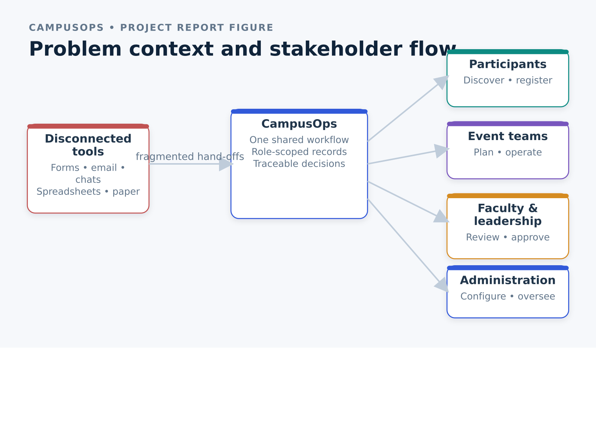

## 1.2 Problem Statement

Campus event operations are often spread across tools that do not share a common source of truth. This creates the following practical problems:

- Event permissions can require repeated manual follow-ups and are difficult to audit.
- Resource availability may be checked independently by different groups, creating a risk of overlapping reservations.
- Registration and eligibility decisions can be inconsistent or difficult to review.
- Paper lists and static passes are difficult to verify quickly and may be reused or copied.
- Event-day complaints can be sent through informal channels without a clear assignment or resolution history.
- Changes to an event may not reach all stakeholders in a timely, traceable way.
- Placement or other scheduled activities can create participant timetable conflicts if managed in isolation.

The central problem addressed is the absence of a unified, role-aware campus operations system that connects event planning, approvals, resources, registration, verification, issue handling and reporting while preserving institutional access boundaries and a reliable audit trail.

## 1.3 Need for the Project

A unified system is useful because campus events involve multiple stakeholders and linked decisions. Digitising only one isolated activity—for example, collecting registrations—does not resolve coordination gaps between permissions, facilities and event-day operations. CampusOps provides a single workflow and a common data model so authorised users can see the records relevant to their responsibilities.

The system is intended to:

- Reduce avoidable manual coordination and repeated follow-ups.
- Make approval ownership, decisions and escalation history visible.
- Prevent conflicting reservations through transactional database enforcement.
- Provide a consistent registration and event access process.
- Give participants and organisers relevant mobile workflows.
- Route event issues to the responsible event team and retain handling history.
- Preserve event records for review and post-event reporting.

## 1.4 Objectives

### Primary objectives

1. Develop a full-stack platform for managing the campus event lifecycle.
2. Implement role- and department-scoped access for institutional users and club teams.
3. Support event creation, revision, submission, approval, publication and completion.
4. Provide a resource catalogue, availability and booking workflow that prevents overlapping reservations.
5. Support participant registration and event-specific access passes.
6. Provide mobile workflows for participants and authorised event operators.
7. Support issue reporting through event/location-specific complaint codes and an assigned resolution trail.
8. Produce traceable post-event reports from stored event data.

### Technical objectives

- Use shared validation schemas and contracts across server and clients.
- Enforce critical invariants in the database as well as in application logic.
- Protect accounts and sessions using secure password hashing and refresh-token rotation.
- Make API contracts discoverable and testable through OpenAPI.
- Organise the project as maintainable, independently structured applications and shared packages.

## 1.5 Scope

### Included in the implemented system

- Account registration, email verification, login, session refresh, logout and password operations.
- Role assignments for institutional and club contexts, with scoped authorization.
- Student verification workflows for college accounts and self-registration for outside participants.
- Club and membership management.
- Event drafting, editing, revision, submission, approval, publication, start, cancellation and completion.
- Separate approval requests for distinct permissions, including escalation and decision history.
- Resource catalogue, units, availability, reservations and booking calendar.
- Event registration, eligibility decisions and registration status handling, including waitlisting where applicable.
- Event pass issuance, checkpoint setup, rotating signed QR tokens, scanning and scan records.
- Event/location-specific complaint reporting, assignment, progress updates and resolution trail.
- Announcements, quizzes and related mobile features present in the implementation.
- Immutable event report snapshots and PDF generation/download.
- Administrative operations, audit logging, notification outbox, maintenance jobs and operational safeguards.
- Management web application and Expo/React Native mobile application sharing one API.

### Explicit boundaries

- CampusOps is not a college ERP replacement and does not claim integration with an institutional identity provider or existing ERP.
- Payments, budget settlement and commercial ticketing are not part of the implemented core.
- The system does not claim that a QR scan alone proves a person’s identity; configured identity checks require an operator to compare the participant with the relevant ID information.
- Actual email delivery, object storage credentials and deployment integrations must be configured in the target environment. Code paths that require absent configuration report failure rather than pretending to complete the external operation.
- The current web interface is a management console, not a student web portal. Students use the mobile application for student-facing workflows.
- Campus-wide production adoption, multi-institution tenancy and live load characteristics require deployment-specific validation.

## 1.6 Limitations

- Real-world outcomes depend on accurate institutional data, staff adoption and correct configuration of roles, departments, clubs and resources.
- Availability of email, file storage, scheduled jobs and push notifications depends on correctly configured external services.
- The application’s automated tests validate software behavior but do not substitute for a live institutional pilot or independent security certification.
- Mobile performance and offline behavior are bounded by device, operating-system and network conditions.
- The system currently requires authorised staff or club roles for management functions; it does not automate institutional policy decisions.
- Large-scale concurrency and disaster recovery must be verified against the actual hosting and database plan before a high-stakes deployment.

## 1.7 Key Contributions

- A connected event lifecycle model spanning planning through post-event reporting.
- A scoped role model for institutional staff, departments and clubs.
- Independent approval requests with decisions, escalation and audit history.
- Database-backed prevention of overlapping resource reservations.
- Secure event access using short-lived signed QR tokens with single-use nonces and scan audit records.
- A distinct complaint QR workflow connecting physical event locations to the responsible event team.
- A shared TypeScript codebase across API, web, mobile and domain packages.
- Automated tests, generated API documentation, migration and deployment documentation supporting maintainability.

---

# CHAPTER 2: RESEARCH AND REQUIREMENTS ANALYSIS

## 2.1 Domain Overview

Campus operations involve workflows crossing organisational boundaries. An organiser proposes an event, but the proposal may require review by faculty, department leadership or institutional administration. A venue or equipment request has its own availability constraints. Participant selection can depend on eligibility rules, invitations or a quiz. During the event, access may be checked at multiple checkpoints and operational issues may need to be routed to event staff. After completion, the institution may need a durable record of decisions, resources and participation.

The domain therefore has several important characteristics:

- **Multiple actors:** students, event coordinators, faculty, department leaders and administrators.
- **Scoped authority:** users should see and change records only within their institutional or club responsibilities.
- **Stateful workflows:** events and approvals move through constrained lifecycle states.
- **Concurrent use:** multiple organisers may request the same rooms or equipment.
- **Auditability:** decisions and operational actions should remain attributable and reviewable.
- **Mobile context:** registration, digital passes, scanning and issue reporting may occur away from a desk.

## 2.2 Existing Approaches and Gaps

Common approaches include paper applications, spreadsheets, email, messaging groups and independent forms. Each can be useful for a limited task, but using several disconnected methods creates duplicated data and uncertainty about which record is current.

| Existing approach | Typical value | Gap addressed by CampusOps |
|---|---|---|
| Paper approval forms | Familiar, can carry signatures | Slow status visibility, difficult search and audit, physical follow-up |
| Shared spreadsheets | Flexible and quick to start | Weak workflow enforcement, conflicting edits, access scope complexity |
| Messaging groups | Fast informal communication | Decisions and files become difficult to retrieve; unclear official status |
| Separate registration forms | Collects participant information | Detached from approvals, eligibility, access and reporting |
| Manual venue calendars | Basic visibility | Concurrent requests can still overlap without enforced reservation rules |
| Printed entry lists/static codes | Simple at small scale | Slow checking and weak replay protection; limited event-linked audit |

CampusOps does not assume every institution has identical rules. Instead, it models roles, approval requests, event state, resources and event checkpoints as structured records so that institutional configuration can define the actual workflow.

## 2.3 Stakeholders and Roles

| Stakeholder | Main responsibilities in the system |
|---|---|
| Student / participant | Register, view eligible events, apply/register, access passes, view announcements and report event issues where permitted |
| Event coordinator / club lead | Create and revise events, request permissions/resources, manage registrations and event operations, issue event reports |
| Club coordinator | Perform permitted event operations for the relevant club |
| Club faculty | View relevant club events and support authorised event operations, including scanning where assigned by the workflow |
| Faculty | Review relevant approval requests and verify eligible college student accounts |
| HOD/Dean | Perform department/category-scoped oversight, approvals and club-related administration |
| Administrator | Institution-level management of users, roles, departments, programmes and operational settings |
| Support | Restricted support functions as granted by the application’s role model |

The actual permissions are enforced server-side from database-backed roles and scope. A client-provided department, club or event identifier is not treated as proof of authority.

**Figure 2: CampusOps event lifecycle**

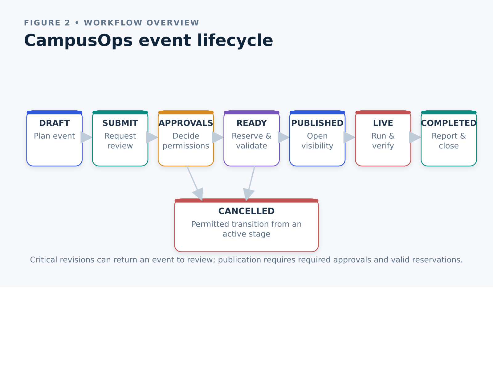

## 2.4 Functional Requirements

### Identity and access

- The system shall allow a user to register and verify an email address.
- The system shall authenticate users and establish refreshable sessions.
- The system shall support password change/reset and logout.
- The system shall restrict actions by role and relevant department/club/event scope.
- The system shall permit authorised faculty to verify college student accounts.
- The system shall provide account export and account anonymisation/deletion workflows.

### Club and event management

- Authorised users shall create and maintain clubs and memberships.
- An authorised event team shall create an event draft and maintain its details.
- Critical event changes shall be revision-aware and require appropriate reapproval.
- Organisers shall submit an event and view its lifecycle and audit history.
- The workflow shall support approval, escalation, rejection/cancellation and publication under the configured rules.
- Authorised users shall start and complete events.

### Approvals and resources

- The system shall represent separate permissions as separate approval requests.
- Approvers shall be able to decide, reassign or escalate where authorised.
- The system shall maintain versions/history to detect stale approval decisions.
- Users shall search resources and their availability.
- Organisers shall reserve resource units for event time ranges.
- Overlapping reservations for the same unit shall be rejected transactionally.
- Temporary holds shall expire according to configured policy.

### Registration and participation

- Participants shall view events visible to them and register or apply where permitted.
- The system shall evaluate eligibility and record a registration status.
- The system shall support capacity limits and waitlisting where configured.
- Quiz-driven selection shall follow the configured quiz policy rather than silently falling back to another admission mode.
- Participants shall view their registrations and issued passes in the mobile application.

### Event access and operations

- Authorised organisers shall configure event checkpoints.
- The system shall issue passes only to eligible confirmed participants.
- The mobile application shall request a short-lived token for a pass/checkpoint.
- The backend shall validate token signature, expiry, nonce, pass status, event/checkpoint state and configured usage limits.
- The scanner shall record the decision, outcome, reason, participant, checkpoint, scanner and timestamp.
- A checkpoint may require an operator to verify the participant’s identity.
- Organisers shall create complaint-reporting locations for an event.
- A participant shall be able to submit a complaint from the relevant event/location QR, subject to authorisation rules.
- Event organisers shall manage complaint assignment/status and preserve update history.

### Reporting and administration

- Authorised users shall generate a versioned post-event report.
- Issued report snapshots shall be immutable and integrity-checked.
- The report shall distinguish registration totals from verified attendance when physical check-in evidence is unavailable.
- Administrators shall manage users, staff assignments, departments, programmes and relevant configuration within their authority.
- The system shall maintain audit and operational records for relevant actions.

## 2.5 Non-Functional Requirements

### Security and privacy

- Passwords must be hashed using a modern password-hashing algorithm.
- Access tokens must be short-lived; refresh tokens must be stored safely, rotated and revocable.
- Sensitive endpoints must apply server-side authentication, authorization and input validation.
- Personal and file data must not be exposed beyond the intended scope.
- Operational logs must avoid recording secrets and unnecessary personal data.

### Integrity and reliability

- Database constraints must protect important invariants such as unique identities, referential integrity and resource conflict prevention.
- Important multi-step operations must be transactional.
- Idempotency keys shall protect selected create operations from accidental duplicate submission.
- Stale concurrent edits shall be detected rather than silently overwriting newer changes.
- Issued reports and audit records shall be protected against in-place modification.

### Usability and accessibility

- Interfaces should present role-appropriate navigation and clear action states.
- Forms should provide validation feedback and understandable errors.
- Mobile workflows should be usable on common phone-sized screens.
- Loading, empty and error states should be represented rather than left ambiguous.

### Maintainability and interoperability

- Applications and shared domain logic should have clear module boundaries.
- API behavior should be documented and contract-tested.
- Database changes should be reproducible through migrations.
- The system should support web and native mobile clients through a stable API.

### Performance and scalability

- Common user actions should complete with acceptable latency at expected campus-scale usage.
- List endpoints should be bounded/paginated where appropriate.
- Actual production capacity must be established through environment-specific load tests and monitoring; no unmeasured throughput guarantee is claimed in this report.

## 2.6 Feasibility Analysis

### Technical feasibility

The application uses established web and mobile frameworks and a relational database. Its main workloads—identity, CRUD operations, workflow transitions, reservations and reports—are supported by the selected stack. Shared schemas and automated tests reduce divergence between API validation and client expectations. Technical feasibility is therefore strong for a single-institution system, subject to environment configuration and deployment validation.

### Operational feasibility

The system reflects familiar campus roles and activities. Its operational success depends on the institution configuring accurate roles, clubs, departments, resources and approval policies, and on event teams using the system as the authoritative record. A pilot with representative users is appropriate before institutional-wide reliance.

### Economic feasibility

The project is built from open-source technologies and can be hosted using a modest web/API/database/object-storage setup. Recurring hosting, email, storage, backup and support costs depend on provider selection and real usage. These costs should be evaluated by the institution before production adoption.

### Schedule and individual-work feasibility

The implementation was developed as an individual project by Vineet Kumar Sahu. Work was organised into iterative technical areas—requirements and architecture, data model/API, management web, mobile workflows, integration, testing and documentation—rather than as a three-person team allocation. This report describes the completed implementation and does not reproduce preliminary evaluation deadlines as project results.

---

# CHAPTER 3: METHODOLOGY AND PROJECT PLANNING

## 3.1 Development Methodology

CampusOps was developed iteratively. The work began by identifying the lifecycle and actors, then expressing the important entities, states and access boundaries in a shared domain model. API and database behavior were developed alongside the user interfaces, with tests used to check business rules and integration paths.

An iterative approach was appropriate because the project combines several linked domains. A change to an event approval rule can affect resource reservation, publication, registration and reporting. Incremental implementation made it possible to establish stable foundations first and extend the system without treating each feature as a separate, disconnected application.

The broad development sequence was:

1. Problem definition, stakeholder identification and scope.
2. Architecture, role model, event lifecycle and data model.
3. Authentication, authorization, shared schemas and API foundation.
4. Event, approval, club and resource workflows.
5. Registration, mobile participation and event-day features.
6. Reports, administrative workflows and operational hardening.
7. Integration testing, documentation and final review.

## 3.2 Work Breakdown Structure

| Work package | Main activities | Deliverable |
|---|---|---|
| Requirements and domain | Define stakeholders, permissions and event workflow | Functional scope and domain rules |
| Data and API foundation | Define schemas, migrations, validation and routes | PostgreSQL schema and API |
| Identity and security | Registration, verification, sessions, role/scope checks | Protected user flows |
| Club and event operations | Membership, events, revisions, approvals and lifecycle | Management workflows |
| Resource operations | Catalogue, availability, holds and reservations | Conflict-aware booking |
| Participant operations | Event visibility, eligibility, registration and passes | Participant workflow |
| Mobile application | Authentication, events, registrations, passes, scanning and complaints | Expo/React Native client |
| Reporting and administration | Management, audit, maintenance and PDF reports | Operational/admin tools |
| Quality and documentation | Automated tests, browser flows, deployment and user-facing docs | Verified, maintainable project |

## 3.3 Project Planning and Work Ownership

This is an individual project. **Vineet Kumar Sahu is the sole student developer and project report author.** Ms. Rubi provided academic guidance. The work areas above describe the sequence and scope, not separate team-member ownership.

Implementation was treated as complete for this report. Preliminary deadlines and evaluation checklists contained in the supplied planning/presentation material are not represented as outcomes or substituted for implementation evidence.

## 3.4 Risk Management

| Risk | Mitigation in the design or process |
|---|---|
| A user acts outside their authority | Server-side role and scope checks derived from database records |
| Concurrent resource requests overlap | PostgreSQL exclusion constraint and transactional reservation handling |
| Duplicate submissions create duplicate records | Idempotency keys on selected mutation workflows |
| Concurrent edits overwrite one another | Revision/version checks and conflict responses |
| A QR screenshot is replayed | Short-lived signed token and single-use nonce validation |
| Secret or personal data leaks through logs | Redacted structured logging and server-side secrets |
| External services are unavailable | Explicit configuration and failure responses; no false success |
| Scope expands beyond an academic project | Prioritise end-to-end lifecycle and clearly separate future work |
| Report figures overstate attendance | Report states whether evidence is registration-only or includes scans |

---

# CHAPTER 4: SYSTEM DESIGN

## 4.1 Overall System Architecture

CampusOps uses a client–API–database architecture with shared domain definitions.

1. **Management web client:** React and Vite application for authorised institutional staff and club/event teams.
2. **Mobile client:** Expo and React Native application for students/participants and authorised event operators.
3. **API server:** Bun runtime with Hono routes, middleware and domain services.
4. **Shared package:** TypeScript domain rules, validation schemas, enums, types and display labels shared by clients and server.
5. **Persistence:** PostgreSQL accessed through Drizzle ORM and versioned migrations.
6. **Supporting services:** Optional S3-compatible private object storage and transactional email providers; deployment configuration controls their use.

**Request flow:** Web client → same-origin `/api/v1` endpoint → API authentication/validation/authorization → domain operation and database transaction → standard response. Native mobile clients call the configured API origin. The browser-facing clients do not depend on a hard-coded localhost backend.

Responses use a consistent envelope: success responses contain `data` and a `requestId`; failures contain a structured error with code, message and details plus a `requestId`.

**Figure 3: Layered system architecture**

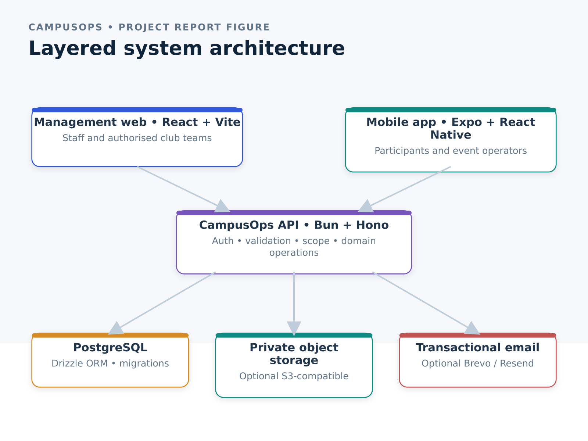

## 4.2 System Modules

- **Authentication:** account creation, email verification, login, refresh, logout and password operations.
- **Identity and access:** roles, department scope, club membership and account status.
- **Club management:** club records, memberships and role assignment.
- **Event management:** event lifecycle, revisions, invitations, eligibility and audit history.
- **Approval management:** separate approval requests, decisions, reassignment and escalation.
- **Resource management:** resource catalogue, units, availability, holds and reservations.
- **Registration:** eligibility evaluation, capacity, confirmed/waitlisted/application states and history.
- **Access operations:** checkpoints, passes, token nonce issuance, scanning and access logs.
- **Complaints:** event-specific locations, poster generation, reports and handling updates.
- **Announcements and quizzes:** event communication and configured selection workflows.
- **Reporting:** immutable event report snapshots and downloadable PDFs.
- **Administration and maintenance:** institutional configuration, audit, outbox and scheduled maintenance.

## 4.3 Data Flow Diagrams

### 4.3.1 Context-level DFD

External actors interact with the CampusOps platform:

- **Participant** sends account, event discovery, registration, pass and complaint requests; receives event information, status, pass and issue updates.
- **Event organiser** sends event, permission, resource, registration and operational actions; receives approval, booking, participant and report information.
- **Faculty / HOD / Dean / Administrator** send verification, approval and administration decisions; receive scoped queues and status information.
- **External email/storage services** receive only the configured service requests for email delivery or private file operations.

The system returns only information permitted by the actor’s role and scope.

**Figure 4: Context-level data flow diagram**

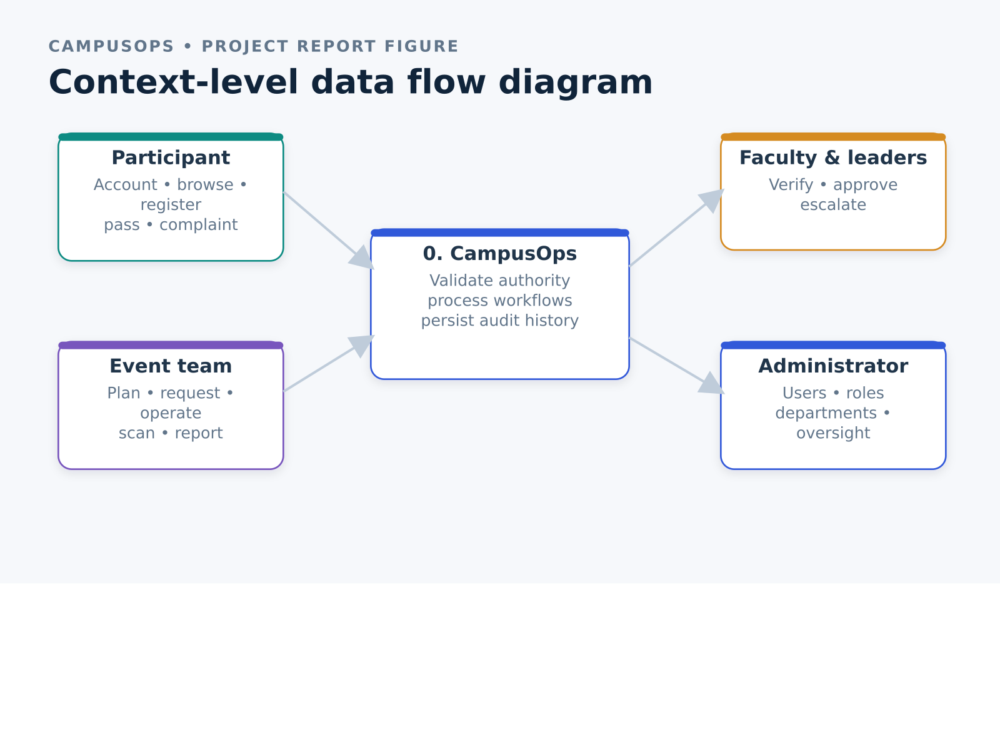

### 4.3.2 Level 1 DFD

The platform decomposes into these processes:

1. Identity and account access.
2. Club and membership administration.
3. Event lifecycle management.
4. Approval and escalation processing.
5. Resource availability and reservation.
6. Participant registration and eligibility.
7. Pass issuance, QR verification and scan logging.
8. Complaint intake and resolution.
9. Reporting, audit and notification dispatch.

Primary data stores include users and role assignments, departments, clubs and memberships, events and revisions, approvals and actions, resources and reservations, registrations and history, passes/checkpoints/scans, complaint locations and updates, files, audit logs, outbox entries and event reports.

**Figure 5: Level 1 data flow diagram**

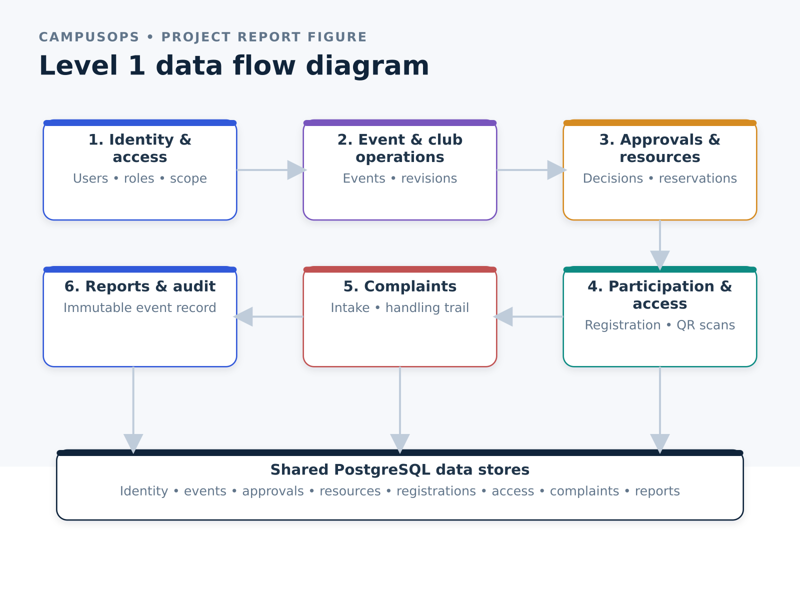

### 4.3.3 Level 2 DFD: event access scan

1. The authenticated operator opens a checkpoint scanner.
2. The participant displays a rotating pass token associated with a pass and checkpoint.
3. The scanner submits the token to the API.
4. The API validates signature and expiry, consumes/checks the nonce, verifies pass and registration state, checks checkpoint/event state and configured use limits, and applies identity-check requirements.
5. The API records the decision and reason in the scan log.
6. The client receives a grant/deny result and displays it to the operator.

A rejected scan does not silently become a successful redemption. Scan processing and use-limit handling are protected against concurrent scans.

## 4.4 Entity-Relationship Design

The production schema is richer than a minimal classroom ERD. The following are principal entity groups and their relationships:

- A **User** may have a student profile or staff profile and one or more role assignments.
- A **Department** contains scoped staff/programme relationships and may be associated with clubs.
- A **Club** has memberships and is associated with event ownership.
- An **Event** has revisions, tags, invitations, approval bundles, registrations, resources, checkpoints, complaints and reports.
- An **Approval bundle** groups a set of separate **approval requests**; each request has decision/action history and may be associated with resource requests.
- A **Resource** has one or more **resource units**; bookings create **reservations** linked to events and time intervals.
- A **Registration** links a participant and event, with status history and, when eligible, an associated **Pass**.
- A **Pass** is used at one or more **Checkpoints**; token nonces, redemptions and scan logs support replay prevention and audit.
- A **Complaint location** belongs to an event and may receive **Complaints**; complaint updates form the handling trail.
- An **Event report** stores an immutable snapshot and integrity checksum.

Foreign keys, uniqueness rules, check constraints, exclusion constraints and append-only protections enforce important data invariants. The full schema is maintained through migrations and includes additional operational entities for tokens, files, notifications, audit and jobs.

**Figure 6: Simplified entity relationship diagram**

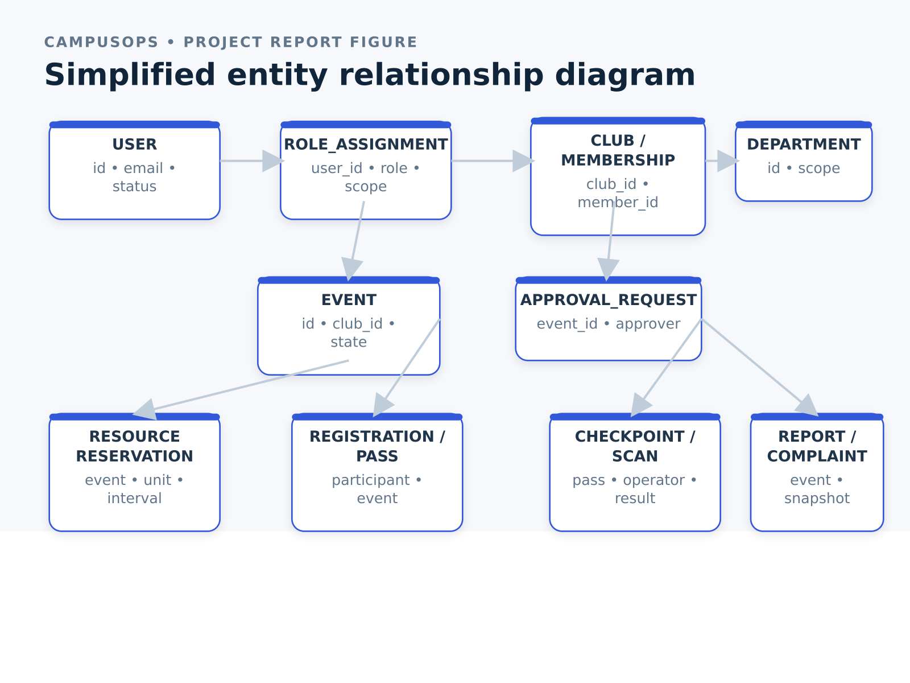

## 4.5 Database Design and Integrity

PostgreSQL is used because the application requires relational integrity, transactions and concurrency-safe reservation rules. Important design choices include:

- User identity and role assignment are separated from event/club membership.
- Event revisions preserve the history of significant changes.
- Approval requests and actions retain independent permission decisions and audit history.
- Resource reservations use half-open time intervals and a database exclusion constraint to prevent overlapping confirmed/held bookings for a unit.
- Foreign keys and check constraints enforce valid references and enumerated states.
- Idempotency records prevent duplicate processing for selected operations.
- Audit logs and issued event reports are append-only at the database level.
- Indexes support common lookups by identity, scope, status and related entity.

## 4.6 Use Case Summary

### Participant

- Register and verify account.
- Sign in and manage permitted account information.
- Browse visible events and event details.
- Register/apply and view eligibility or waitlist state.
- View announcements and digital passes.
- Present a pass at an authorised checkpoint.
- Report an issue from a valid event complaint location and follow its status.
- Participate in an event quiz when configured.

### Event organiser / club team

- Manage permitted event drafts and revisions.
- Request individual permissions and resources.
- Submit event for approval and track decisions.
- Manage event registration and operational state.
- Configure checkpoints and issue eligible passes.
- Scan/inspect passes where authorised.
- Create complaint locations and manage reports.
- Generate and download event reports.

### Faculty and institutional leadership

- Review only in-scope approval requests.
- Approve, reject, reassign or escalate where permitted.
- Verify eligible college student accounts (faculty workflow).
- Manage scoped clubs and related staff functions where authorised.

### Administrator

- Manage users, roles, departments and institutional configuration within the administrator scope.
- Review operational records and system administration functions.

## 4.7 API Design Overview

The API is versioned under `/api/v1`. Routes use HTTP methods appropriate to the operation and share Zod request/response schemas. OpenAPI 3.1 documentation is served by the API and generated from the same validation contracts used by routes. A contract test checks parity between mounted operations and documented operations.

Representative route families include:

- `/auth/*`, `/me` — identity and account operations.
- `/clubs/*`, `/me/clubs` — club administration and membership.
- `/events/*`, `/me/events` — event lifecycle and participant/event views.
- `/approvals/*`, `/approval-requests/*` — approval inbox and decision lifecycle.
- `/resources/*`, `/resource-units/*` — catalogue, availability and reservations.
- `/events/:id/passes/*`, `/access/*` — pass issuance, nonce generation, checkpoint and scan operations.
- `/events/:id/complaints/*`, `/complaints/*` — complaint locations, reports and handling.
- `/events/:id/reports/*` — report preview, generation, version retrieval and PDF download.
- `/admin/*` — administrative operations.

The API uses authentication middleware, role/scope checks, validation, rate limiting, request IDs, idempotency on selected operations and structured error responses.

---

# CHAPTER 5: IMPLEMENTATION

## 5.1 Technology Stack

| Layer | Technology | Purpose |
|---|---|---|
| Language | TypeScript | Shared typed implementation across clients and API |
| Runtime | Bun | API execution and project tooling |
| API framework | Hono | HTTP routing and middleware |
| Validation/contracts | Zod, OpenAPI 3.1 | Runtime input validation and API documentation |
| ORM | Drizzle ORM | Typed PostgreSQL access and schema management |
| Database | PostgreSQL (Neon-compatible deployment) | Persistent transactional data |
| Management web | React, Vite | Browser-based institutional management console |
| Mobile | Expo, React Native | Participant and event-day mobile workflows |
| Shared package | TypeScript domain package | Enums, schemas, labels and domain rules |
| Object storage | S3-compatible provider (optional/configured) | Private media and document storage |
| Email | Brevo or Resend (optional/configured) | Transactional email through an outbox |
| Testing | Bun test suite and browser E2E scripts | Unit, integration, contract and workflow testing |

The exact dependency versions are recorded in the project manifests and lockfile.

## 5.2 Backend Development

The backend is organised around API routes, middleware, domain logic and data access. Authentication middleware resolves the session and role assignments; authorization functions establish the relevant event, club or department scope from stored records. Request data is validated before business operations. Database transactions are used where a workflow spans related records.

The API includes operational safeguards such as request identifiers, structured/redacted logging, body-size limits, security headers, rate limits, idempotency, database retry behavior where appropriate and maintenance jobs. The API publishes a health surface and generated OpenAPI document. API responses use consistent success/error structures so the web and mobile clients can handle outcomes predictably.

## 5.3 Frontend Development

### Management web application

The web application provides authorised staff and club teams with event, approval, resource, registration, complaint, report and administrative workspaces. It uses a shared API wrapper, session context, role-aware navigation and reusable interface components. Management actions are presented with state, validation and error feedback. The web application is intentionally not a student portal; users without management permissions are directed to the mobile application for participant activities.

### Mobile application

The Expo/React Native application supports account access, event browsing and details, registrations, digital passes, scanning, complaints, announcements, quizzes and profile/account operations present in the implementation. It shares the API and domain contracts with the server and web application. Native refresh credentials are kept in platform secure storage; access tokens are held in memory. Camera/scanner and device capabilities are used only in the relevant event operations.

## 5.4 Authentication and Security

- Passwords are stored as Argon2id hashes, not plaintext.
- Short-lived HS256 JWT access tokens are held in memory by clients.
- Opaque refresh tokens are stored hashed with a pepper, rotated on refresh and protected against reuse.
- The web refresh token is carried in an httpOnly, SameSite cookie with production Secure behavior; the native application uses secure device storage.
- Account lifecycle states prevent pending, rejected or suspended accounts from accessing protected operations.
- Role and scope checks are made on the server and do not trust client-supplied scope identifiers.
- Request schemas validate and constrain user input; response errors do not expose secrets or stack details.
- Access QR tokens are short-lived, HMAC-signed and bound to pass/checkpoint context; one-time nonces prevent replay.
- Files use private storage and short-lived signed URLs when storage is configured. Disabled storage returns an explicit unavailable response.
- Audit records capture relevant actions; secrets are redacted from logs.

Security implementation does not constitute an independent penetration test or certification. Production adoption requires environment-specific security review and operational controls.

**Figure 7: Authentication and refresh-token flow**

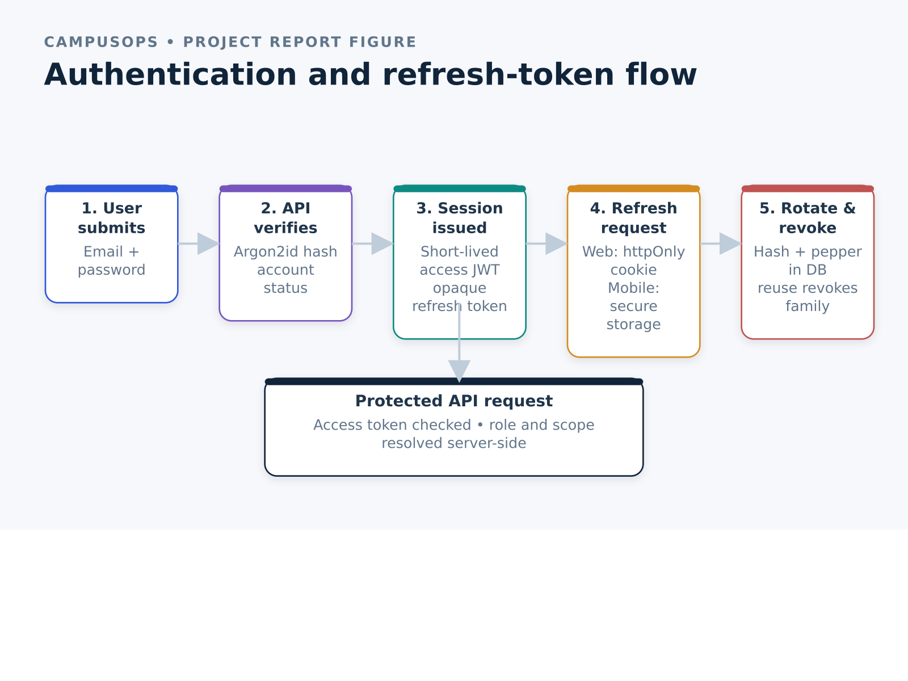

**Figure 8: Approval and resource booking flow**

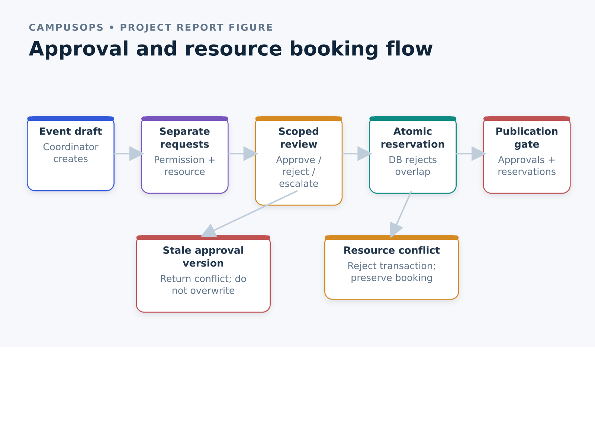

## 5.5 Key Features Implemented

1. **Role-aware identity:** student, faculty, department leadership, administrator, support and club roles, with relevant scope restrictions.
2. **Club management:** clubs, membership and role-related operations.
3. **Event lifecycle:** draft, submission, approval readiness, publication, live operation, completion and cancellation, with revisions.
4. **Independent approvals:** distinct permission requests with versioning, actions and escalation history.
5. **Resource booking:** resource catalogue and units, availability, holds and conflict prevention in PostgreSQL.
6. **Registration and eligibility:** participant registration/application state, eligibility decisions, capacity handling and waitlist behavior as configured.
7. **Event access:** pass issuance to eligible registrations, checkpoints, short-lived QR nonce tokens, scan outcomes and access history.
8. **Event issue reporting:** printable complaint-location QR, event-specific complaint inbox, assignment/status changes and reporter-visible history.
9. **Quiz and announcements:** event-linked participation/communication workflows included in the application.
10. **Post-event reports:** versioned, immutable report snapshot, checksum validation and PDF output; attendance claims reflect available evidence.
11. **Administration:** user/staff, department, programme and platform operations within role scope.
12. **Operational foundations:** notification outbox, maintenance jobs, audit, API documentation and structured error handling.

**Figure 9: Event access QR verification flow**

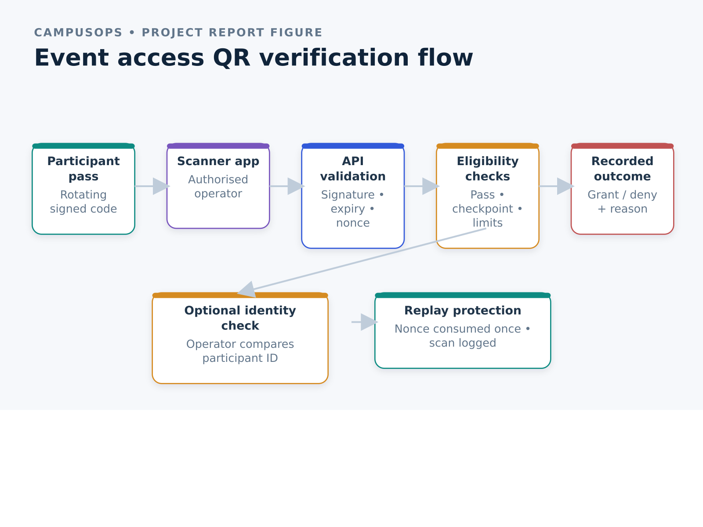

**Figure 10: Complaint QR and event issue-handling flow**

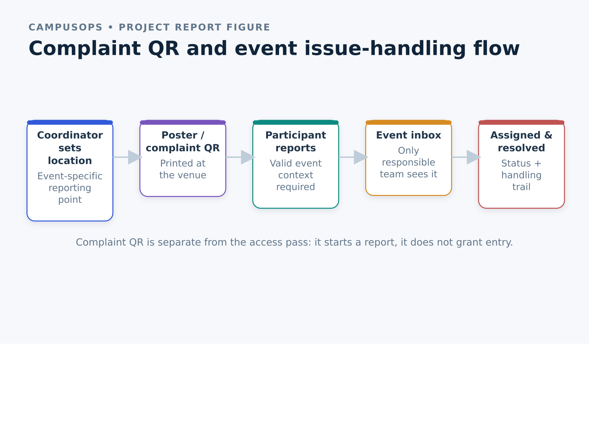

## 5.6 Deployment and Configuration

The repository documents a deployment shape with the web client on a static web host, the Bun API on a Bun-capable long-running host, PostgreSQL as the database and optional S3-compatible storage and email provider. Environment variables configure secrets and integrations; secrets are not committed. The web client uses relative API paths behind a same-origin proxy/rewrite, while native builds are configured with an API origin. Scheduled maintenance can run in-process or through an external scheduler depending on hosting behavior.

A local environment requires dependency installation, environment configuration, database migrations and optional seed data. A production deployment additionally requires secure secret generation, TLS, database backups, email/storage credentials, allowed origins, monitoring and a rehearsed restore process.

---

# CHAPTER 6: TESTING AND RESULTS

## 6.1 Testing Strategy

Testing is performed at multiple levels:

- **Unit/domain tests:** validate pure rules such as role behavior, event/access decisions, eligibility and quiz logic.
- **API contract tests:** validate route schemas, response behavior and OpenAPI parity.
- **Integration tests:** exercise API operations against a test database, including accounts, clubs, events, approvals, resources, registrations, reports, complaints and access operations.
- **Security/authorization tests:** verify scope boundaries, role restrictions, stale versions, replay protection and sensitive lifecycle rules.
- **Browser end-to-end tests:** exercise management and mobile-preview workflows through real user interfaces where configured.
- **Build and static checks:** linting, TypeScript checks and application builds.

Some integration tests require PostgreSQL features (including the `btree_gist` extension for exclusion constraints) and a configured test database. Tests requiring unavailable services or credentials are not treated as having passed against real third-party services.

## 6.2 Representative Test Cases and Results

The following table describes behaviors covered by the project’s automated test suite. “Pass” means a corresponding automated test is present and passes in the documented configured test environment; it does not mean a live college deployment or third-party provider has been independently certified.

| Test scenario | Expected behavior | Result |
|---|---|---|
| Valid account registration and email verification | Account follows permitted status transitions | Pass in automated suite |
| Invalid credentials or inactive account | Authentication is refused | Pass in automated suite |
| Refresh token rotation and reuse | Valid refresh rotates; reuse revokes the token family | Pass in automated suite |
| Student attempts management-only route | Access denied or management tools withheld | Pass in automated suite |
| User accesses a record outside department/club scope | No cross-scope data access | Pass in automated suite |
| Stale event revision mutation | Conflict response; newer event state is preserved | Pass in automated suite |
| Stale approval decision | Version conflict rather than silent overwrite | Pass in automated suite |
| Two overlapping resource reservations | Database rejects the conflicting booking | Pass when PostgreSQL test setup includes required extension |
| Duplicate idempotent request | Existing result is returned; mismatched replay is rejected | Pass in automated suite |
| Registration capacity and eligibility | Only permitted outcome/status is persisted | Pass in automated suite |
| Invalid/expired/replayed access token | Scan refused with a reason and audit outcome | Pass in automated suite |
| Participant attempts to use another person’s pass | Pass/identity checks prevent unauthorised grant | Pass in automated suite |
| Complaint submitted outside event access rules | Request rejected; no unrelated event inbox exposure | Pass in automated suite |
| Issued report update or checksum mismatch | Modification rejected or download verification fails | Pass in automated suite |
| API route/OpenAPI mismatch | Contract test fails if documentation and mounted routes diverge | Pass in automated suite |
| Mobile/web and management workflows | Main configured browser flows complete without application-level failure | Covered by E2E scripts; requires running services and demo configuration |

The repository README records **421 API tests** passing in the documented test run, with **five tests requiring the PostgreSQL `btree_gist` exclusion constraint** and therefore requiring a database configured with that extension. The count is a repository test-suite result, not a claim about production users, load, or uptime. Re-run the suite against the final project state and attach the generated test log when submitting a typeset version if a dated test artifact is required.

## 6.3 Results and Observations

The implementation demonstrates a connected flow from event management through approvals, resources, registration, access operations, complaints and reports. Its central results are structural and functional: workflow states are represented explicitly; permissions are checked server-side; important concurrency rules are enforced in the database; and participant and management experiences share one API and domain model.

The system records decisions and operations so that an event’s history can be reviewed. The resource exclusion constraint addresses double-booking at the database boundary rather than relying only on a prior availability check. Report logic distinguishes registration counts from scanned attendance when checkpoint evidence is absent. The QR access design uses expiry, signature and nonce-consumption checks rather than treating a static QR image as sufficient proof of validity.

No numerical latency, throughput, user satisfaction or real-world adoption results are claimed here because no measured production load test or formal user study is included as evidence in the repository documentation. These should be measured during a campus pilot.

## 6.4 Screenshots and Demonstration Evidence

Insert actual screenshots from the completed application, with captions and the role used. Recommended figures:

1. Management dashboard and event workspace.
2. Event creation or revision form.
3. Approval inbox and decision history.
4. Resource availability/calendar and reservation result.
5. Event registration and participant status.
6. Mobile event feed/detail and registration view.
7. Digital pass and checkpoint scan result.
8. Complaint QR poster and complaint handling screen.
9. Event report preview or generated PDF.
10. Mobile layouts on representative screen sizes.

Before submission, redact live email addresses, phone numbers, tokens, private IDs and any personal data visible in screenshots. Captions should state what the screenshot demonstrates and should not imply an unimplemented feature.

**Figure 11: Sign-in screen of the management console**

The illustration below is a UI reference mockup based on the implemented sign-in panel and its actual labels/flow. Replace it with a fresh screenshot from the running application if the report specifically requires photographic implementation evidence.

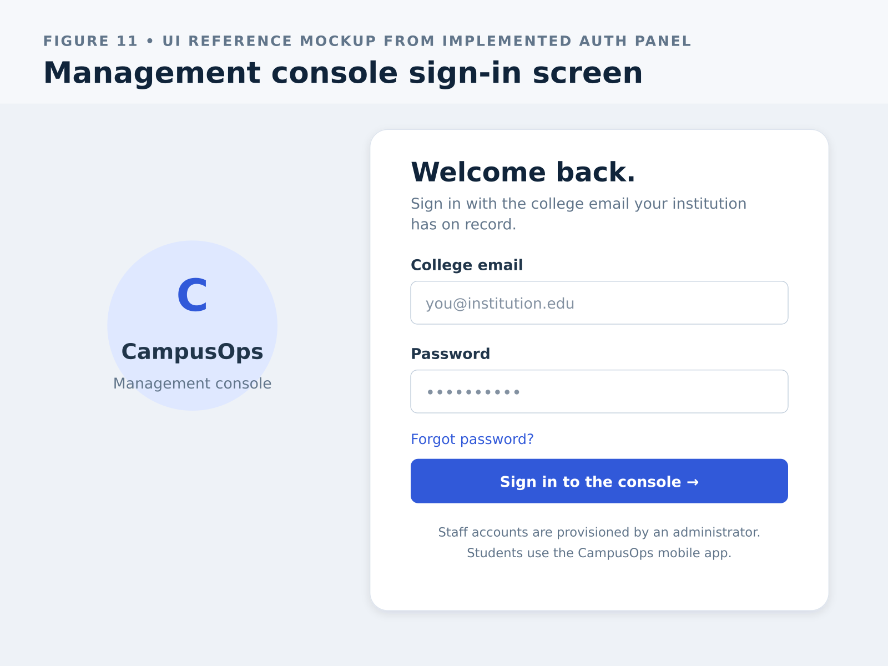

---

# CHAPTER 7: CONCLUSION AND FUTURE SCOPE

## 7.1 Conclusion

CampusOps was developed as a unified campus operations and event lifecycle platform. It addresses the coordination gap between event proposals, institutional approvals, resource booking, registration, access verification, issue handling and post-event reporting. The project combines a management web application, a mobile application, a shared TypeScript domain package, a Bun/Hono API and PostgreSQL persistence.

The implementation goes beyond static event listings. It models role and scope, event revisions, independent approvals, concurrent resource use, participant eligibility, checkpoint-based access, complaint handling and immutable reports. Security and integrity are supported by password hashing, refresh-token rotation, server-side authorization, validation, transaction handling, database constraints, idempotency, audit history and QR replay protection.

The completed system provides a substantial academic implementation and a foundation for a controlled institutional pilot. Its operational success will depend on policy configuration, user onboarding, service availability, security review, backups and real-world usability evaluation. CampusOps should therefore be understood as a completed software project, not as a claim that institution-wide production adoption or all external integrations have already been validated.

## 7.2 Challenges and Learning

### Modelling institutional roles and scope

A role name alone is insufficient where access depends on a department, club or event. The system therefore had to resolve scope from linked records and enforce it in server-side operations. This strengthened understanding of authorization as a domain rule rather than a frontend navigation feature.

### Preserving independent approval decisions

Different permissions may need different approvers and histories. Combining them into one generic approval would obscure accountability. The implementation models separate requests, versions and actions, including escalation.

### Handling concurrent resource requests

Checking availability in application code is vulnerable to two simultaneous requests both observing the same free slot. Database exclusion constraints and transactional operations were used to make the invariant authoritative at persistence time.

### Securing event access

Static QR codes are easy to copy. Short-lived signed tokens, one-time nonces, pass/checkpoint binding and scan logs required careful coordination between the mobile client, API and database.

### Maintaining API and client consistency

Multiple clients can drift from server expectations. Shared Zod schemas, typed contracts and generated OpenAPI documentation help keep request validation and client behavior aligned.

### Building a broad system as an individual project

The project spans web, mobile, API, database, operations and documentation. Modular structure, incremental implementation and automated tests were important for keeping the system understandable and verifying changes.

## 7.3 Future Enhancements

The following are possible extensions and should not be read as implemented unless verified in a later release:

1. **Institutional SSO/ERP integration:** connect to official identity and student information systems using approved interfaces.
2. **Measured load testing:** simulate registration openings, concurrent scans and busy approval periods; publish capacity results.
3. **Operational monitoring:** add production dashboards, alerting, retention policies and incident procedures.
4. **Backup and disaster recovery:** automate backups and rehearse restoration against a documented recovery objective.
5. **Accessibility evaluation:** conduct keyboard, screen-reader, contrast and low-end-device reviews with representative users.
6. **Offline scanner resilience:** extend and validate offline queue synchronization under conflicting or duplicated scans.
7. **Scheduling and placement module:** add a dedicated interview scheduling workflow with student time-conflict prevention if adopted as a confirmed institutional requirement.
8. **Certificates and financial workflows:** add verified certificate issuance, budgets or expense settlement only after institutional policy and integrations are defined.
9. **Communication integrations:** add approved messaging integrations and event-specific chat only with consent, access controls and retention policies.
10. **Multi-institution support:** add tenant isolation and configurable policies if the system is to serve multiple institutions.
11. **Formal user study:** assess task completion, accessibility, satisfaction and operational improvements with students, faculty and event organisers.
12. **Independent security assessment:** conduct threat modelling, penetration testing and privacy review before handling production institutional data at scale.

---

# REFERENCES

1. Bun, *Bun Documentation*. https://bun.sh/docs  
2. Hono, *Hono Documentation*. https://hono.dev/docs/  
3. React, *React Documentation*. https://react.dev/  
4. Vite, *Vite Documentation*. https://vite.dev/guide/  
5. Expo, *Expo Documentation*. https://docs.expo.dev/  
6. React Native, *React Native Documentation*. https://reactnative.dev/docs/getting-started  
7. PostgreSQL Global Development Group, *PostgreSQL Documentation*. https://www.postgresql.org/docs/  
8. Drizzle Team, *Drizzle ORM Documentation*. https://orm.drizzle.team/docs/overview  
9. Zod, *Zod Documentation*. https://zod.dev/  
10. OpenAPI Initiative, *OpenAPI Specification*. https://spec.openapis.org/oas/latest.html  
11. IETF, *RFC 7519: JSON Web Token (JWT)*. https://www.rfc-editor.org/rfc/rfc7519  
12. IETF, *RFC 9106: Argon2 Memory-Hard Function for Password Hashing and Proof-of-Work Applications*. https://www.rfc-editor.org/rfc/rfc9106  
13. IETF, *RFC 2104: HMAC: Keyed-Hashing for Message Authentication*. https://www.rfc-editor.org/rfc/rfc2104  
14. CampusOps project source code and project documentation, including `README.md` and `docs/architecture.md`, repository checkout, accessed 19 November 2026.  
15. CampusOps, *Synopsis on “CampusOps — Unified Campus Operations & Event Lifecycle Engine”*, submitted by Vineet Kumar Sahu, Global Institute of Technology and Management, Academic Year 2026–2027.  
16. CampusOps, *Project Presentation*, prepared by Vineet Kumar Sahu, B.Tech CSE, Semester 7.

---

# APPENDIX A: REPRESENTATIVE API GROUPS

The complete and current API contract is available from the running application at `GET /api/v1/openapi.json`. The following are representative groups, not a replacement for that versioned contract:

- Authentication and account: `/api/v1/auth/*`, `/api/v1/me`.
- Events: `/api/v1/events`, `/api/v1/events/:id/*`, `/api/v1/me/events`.
- Approvals: `/api/v1/approvals/*`, `/api/v1/approval-requests/:id/*`.
- Clubs: `/api/v1/clubs/*`, `/api/v1/me/clubs`.
- Resources: `/api/v1/resources/*`, `/api/v1/resource-units/:id`.
- Registration and passes: event pass routes and `/api/v1/me/passes*`.
- Scanning: `/api/v1/access/scan`.
- Complaints: `/api/v1/complaints/*` and event complaint routes.
- Reports: event report, preview and PDF routes.
- Administration and jobs: `/api/v1/admin/*`.

# APPENDIX B: IMPORTANT DOMAIN STATES

### Event lifecycle

`DRAFT → PENDING_APPROVALS → READY → PUBLISHED → LIVE → COMPLETED`  
An event may also be cancelled according to permitted transitions. Critical revisions can require renewed approvals.

### Account lifecycle

College accounts may move through email verification and institutional verification before activation; outside participants follow the applicable email-verification path. Suspended or rejected accounts cannot authenticate.

### Access-token validation

A scan is evaluated for replay, expiry, token/checkpoint validity, pass status, registration state, checkpoint activation, event state and schedule, usage limits and any configured identity check. The final outcome is recorded.

### Report integrity

An issued event report is an immutable snapshot. Its checksum is verified before download. If access scans are not configured or available, the report must not present registrations as verified physical attendance.
